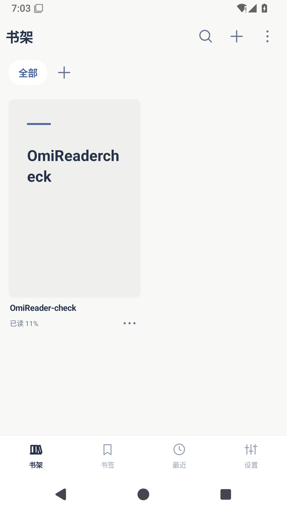
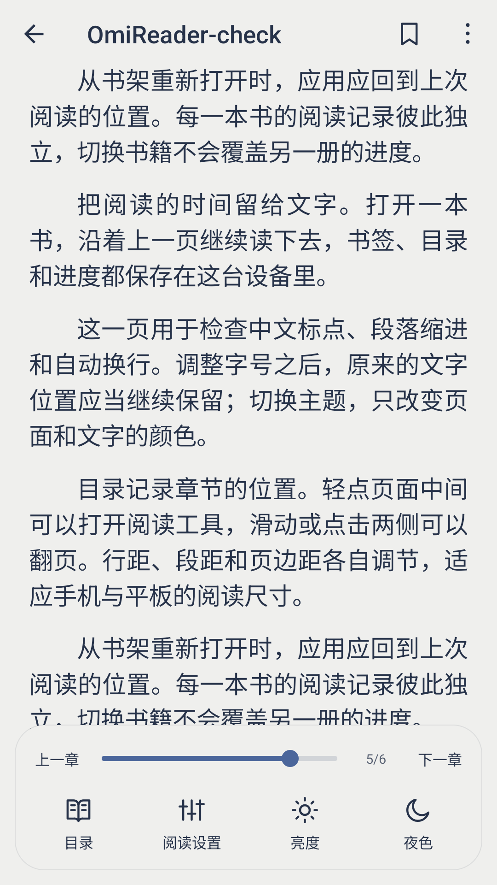
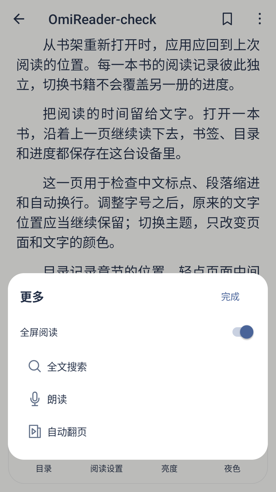
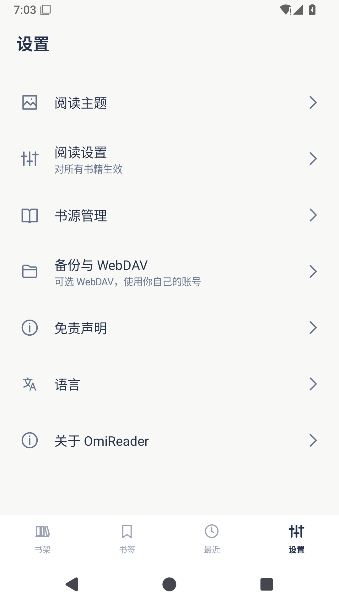
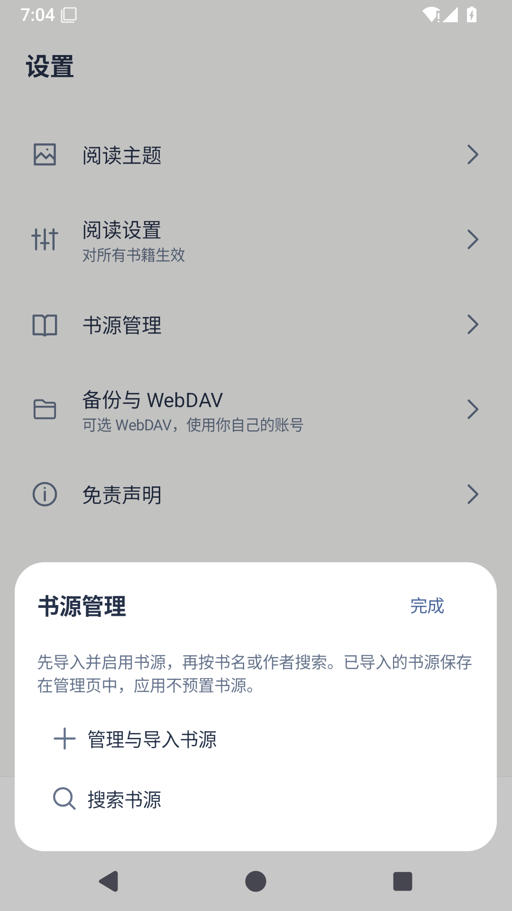
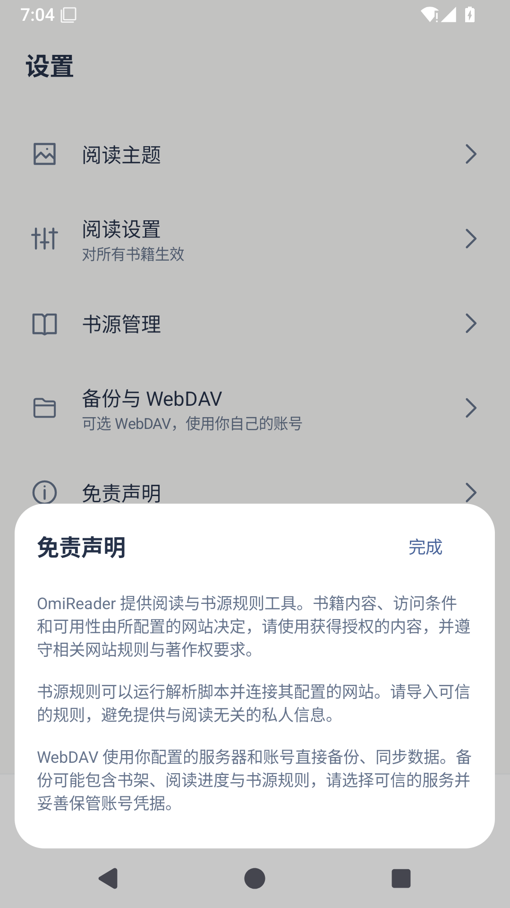

# OmiReader

[简体中文](README.md) · [繁體中文](README.zh-TW.md) · [English](README.en.md) · [日本語](README.ja.md)

[Download APK](https://github.com/lorcinv/OmiReader/releases/latest) · [v1.1.2](https://github.com/lorcinv/OmiReader/releases/tag/v1.1.2)

Android 5.0+ · TXT / EPUB / MOBI / AZW3 / DOCX / Markdown · GPL-3.0

**Make room for reading.**

OmiReader is a clean Android ebook reader centered on local books, with detailed reading controls, library organization, and optional book sources and WebDAV. Its reading core comes from Legado; the interface follows the Omi palette and interactions.

## Screenshots

<table>
<tr><td align="center"> Library and reading progress</td><td align="center"> Reader controls and page progress</td><td align="center"> Reader shortcuts</td></tr>
<tr><td align="center"> Settings</td><td align="center"> Optional book sources</td><td align="center"> Source and WebDAV notice</td></tr>
</table>

## Features

- **Organize your library**: shelves, virtual folders and stacked covers; choose a list or a 2–6 column grid. Long-press to organize and reorder books. A page control appears when the library spans multiple pages.
- **Adjust your reading**: font, size, weight, line and letter spacing, paragraph spacing, indentation, margins, page colors and backgrounds. Choose Mist, Nord, Sand or Night.
- **Find your place**: a bottom panel switches between chapters and bookmarks, with a fixed bookmark button at the top. The progress slider shows the page as you drag; each book keeps its own reading position.
- **Keep the interface simple**: one row of reading tools, immersive fullscreen, gray inactive navigation and a clear selected state. No advertising SDK and no registration requirement.
- **Connect when needed**: import compatible Legado 3.0 JSON source rules and search for books. Back up, restore and sync through your own WebDAV server. No third-party book sources or books are bundled.

## Supported formats

| Format | Support |
| --- | --- |
| TXT | Reflowable text, encoding detection and chapter navigation |
| EPUB | Text, illustrations, contents and reading progress |
| MOBI / AZW3 | KF6 / KF8 text and illustrations; image-only pages fit the reading area |
| DOCX | Paragraphs, headings, lists, tables, links and embedded images |
| Markdown | `.md` / `.markdown`, including headings, lists, quotes, code blocks and tables |

Files must be unencrypted. Use [OmiComic](https://github.com/lorcinv/OmiComic) for PDF; standalone HTML import is not supported. External Markdown images are not fetched automatically. Embedded DOCX images are retained.

## Get started

1. Download the APK from [Releases](https://github.com/lorcinv/OmiReader/releases/latest) and install it. Version 1.1.2 uses the same signing certificate as earlier OmiReader builds and supports an in-place upgrade.
2. Tap the plus button above the library to choose a local book. The More menu contains batch import and library display options.
3. Tap the middle of a reading page to reveal the toolbar. Reading settings keeps the full typography and page-color controls.
4. When creating a shelf or folder, enter its name and tap Done at the top right to save.
5. For online sources, open **Settings → Book sources → Manage and import sources**. Import a local JSON file or URL, enable the source, then use Search book sources. WebDAV is under Backup and WebDAV.

## Data and privacy

Library organization, bookmarks and reading positions are stored on the device. Standard books keep their system-granted local file references where possible; DOCX and Markdown use internal reading copies. Organizing shelves does not move the original files. Book sources and WebDAV connect to the services you configure, without an OmiReader relay server. Settings includes a notice explaining these optional features.

## Languages and development

The app and project documentation are available in Simplified Chinese, Traditional Chinese, English and Japanese. See [BUILDING.md](docs/BUILDING.md) for builds, signing and icon generation, and [CHANGELOG.md](CHANGELOG.md) for version history.

Version 1.1.2 passed 31 Android emulator checks, including an upgrade preserving books and reading progress. Physical-device validation has not been performed. Report problems through [Issues](https://github.com/lorcinv/OmiReader/issues).

## Credits and license

The reading and source-rule core is based on [Legado, by gedoor and contributors](https://github.com/gedoor/legado/tree/da17bb2bed44f30b12a524c2457e32a20b16fa41). Omi icons and interactions follow the same author’s [OmiComic](https://github.com/lorcinv/OmiComic) project. Upstream credits, third-party notices and the [GPL-3.0 license](LICENSE) are retained. The original project introduction is in [UPSTREAM_README.md](docs/UPSTREAM_README.md).
