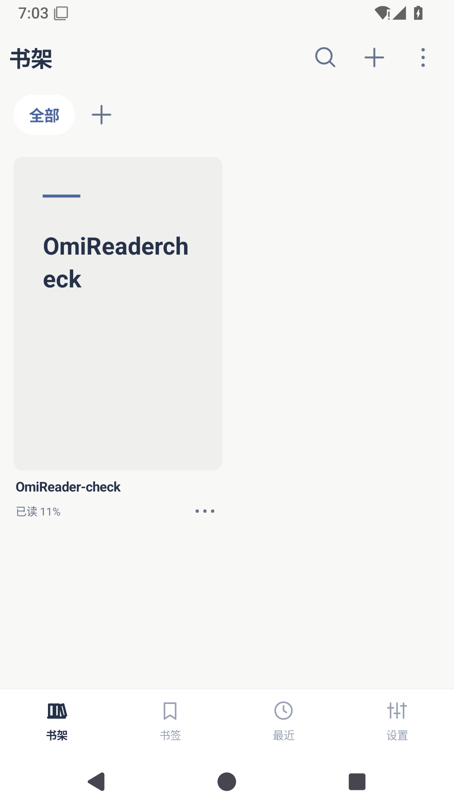
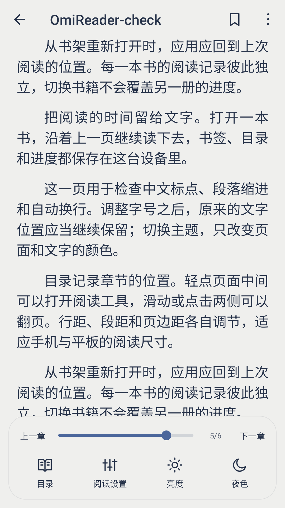
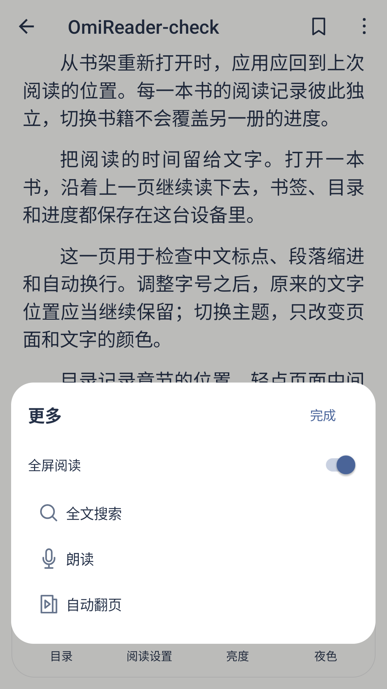
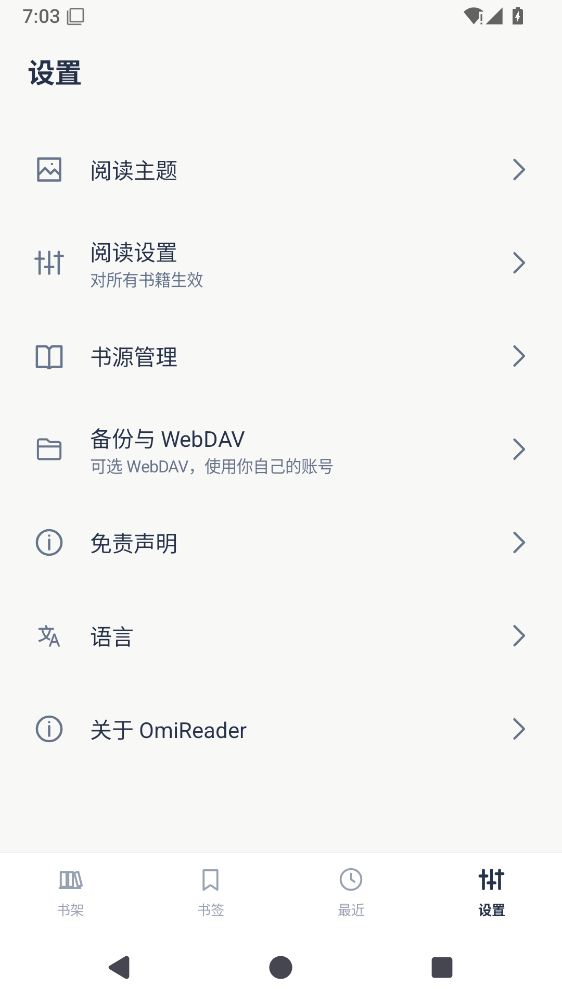
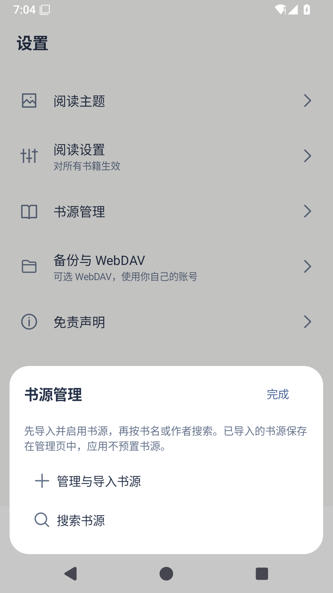
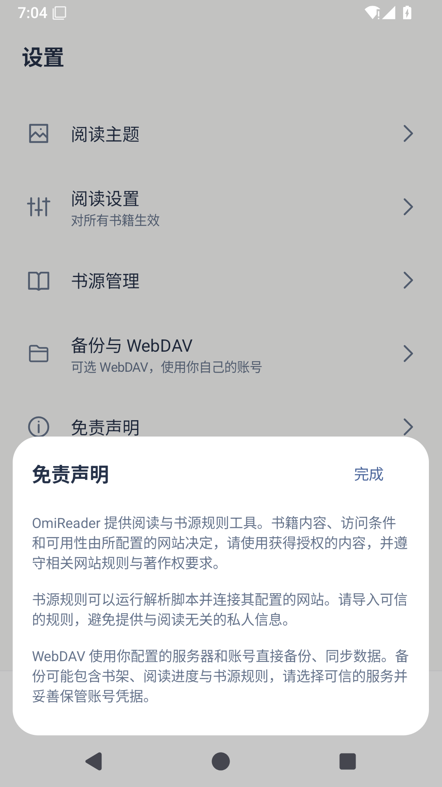

# OmiReader

[简体中文](README.md) · [繁體中文](README.zh-TW.md) · [English](README.en.md) · [日本語](README.ja.md)

[APK をダウンロード](https://github.com/lorcinv/OmiReader/releases/latest) · [v1.1.2](https://github.com/lorcinv/OmiReader/releases/tag/v1.1.2)

Android 5.0+ · TXT / EPUB / MOBI / AZW3 / DOCX / Markdown · GPL-3.0

**読む時間を、文字のために。**

OmiReader は、端末内の本を中心に読めるシンプルな Android 電子書籍リーダーです。細かな読書設定、本棚の整理、必要に応じた書籍ソースと WebDAV を備えています。読書エンジンは Legado を基にし、画面は Omi の配色と操作を採用しています。

## 画面紹介

<table>
<tr><td align="center"> 本棚と読書の進捗</td><td align="center"> 読書設定とページ移動</td><td align="center"> 読書のショートカット</td></tr>
<tr><td align="center"> 設定</td><td align="center"> 任意の書籍ソース</td><td align="center"> 書籍ソースと WebDAV の説明</td></tr>
</table>

## 主な機能

- **本棚の整理**：上部の本棚タブ、仮想フォルダー、重ねた表紙。リスト表示と 2～6 列のグリッドに対応し、長押しで整理や並べ替えができます。複数ページになるとページ切り替えボタンが表示されます。
- **細かな読書設定**：フォント、文字サイズ、太さ、行間、字間、段落間隔、字下げ、余白、ページの色と背景を調整できます。ミスト・ノルド・サンド・ナイトの 4 つの Omi テーマを用意しています。
- **読みたい場所へ移動**：下から開くパネルで目次としおりを切り替えます。しおりボタンは右上に固定され、進捗バーを動かすとページ番号が変わります。本ごとに読書位置を保存します。
- **シンプルな画面**：読書ツールは 1 列に配置し、全画面表示にも対応。下部ナビゲーションは未選択時がグレー、選択時が明るく表示されます。広告 SDK はなく、アカウント登録も不要です。
- **必要なときだけ接続**：互換性のある Legado 3.0 形式の JSON ソースルールを取り込み、書籍を検索できます。自分で設定した WebDAV サーバーでバックアップ、復元、同期が可能です。第三者の書籍ソースや書籍は同梱していません。

## 対応形式

| 形式 | 対応内容 |
| --- | --- |
| TXT | 文字の再配置、文字コードの判別、章の目次 |
| EPUB | 本文、挿絵、目次、読書の進捗 |
| MOBI / AZW3 | KF6 / KF8 の本文と挿絵。画像のみのページは読書領域に合わせて表示 |
| DOCX | 段落、見出し、リスト、表、リンク、埋め込み画像 |
| Markdown | `.md` / `.markdown`。見出し、リスト、引用、コードブロック、表に対応 |

暗号化されていないファイルに対応します。PDF は [OmiComic](https://github.com/lorcinv/OmiComic) をご利用ください。単独の HTML ファイルの取り込みには対応していません。Markdown の外部画像は自動取得せず、DOCX の埋め込み画像は保持します。

## 使い方

1. [Releases](https://github.com/lorcinv/OmiReader/releases/latest) から APK をダウンロードしてインストールします。1.1.2 は以前の OmiReader と同じ署名を使用しており、上書き更新ができます。
2. 本棚上部の「＋」から端末内の本を選びます。「その他」には一括取り込みと表示設定があります。
3. 読書ページの中央をタップするとツールバーが開きます。「読書設定」で文字組みやページの色を調整できます。
4. 本棚やフォルダーを作るときは、名前を入力して右上の「完了」で保存します。
5. 書籍ソースを使う場合は **設定 → ブックソース → 書籍ソースの管理・インポート** を開きます。JSON ファイルまたは URL から取り込み、有効にしてから書籍ソース検索を使います。WebDAV は「バックアップと WebDAV」にあります。

## データとプライバシー

本棚、しおり、読書位置は端末に保存します。通常の書籍は可能な限りシステムで許可されたローカルファイルを参照し、DOCX と Markdown は内部の読書用コピーを使用します。本棚の整理で元のファイルは移動しません。書籍ソースと WebDAV は設定したサービスへ直接接続し、OmiReader の中継サーバーは使用しません。設定内の免責事項で各機能の説明を確認できます。

## 言語と開発

アプリとプロジェクトの説明は簡体字中国語、繁体字中国語、英語、日本語に対応しています。ビルド、署名、アイコン生成は [BUILDING.md](docs/BUILDING.md)、更新内容は [CHANGELOG.md](CHANGELOG.md) を参照してください。

1.1.2 は Android エミュレーターの 31 項目の検証を通過し、本と読書位置を保持した上書き更新も確認しています。実機での検証は行っていません。不具合は [Issues](https://github.com/lorcinv/OmiReader/issues) へお寄せください。

## 謝辞とライセンス

読書とソースルールのエンジンは、[gedoor と貢献者による Legado](https://github.com/gedoor/legado/tree/da17bb2bed44f30b12a524c2457e32a20b16fa41) を基にしています。Omi のアイコンと操作は同じ作者の [OmiComic](https://github.com/lorcinv/OmiComic) に準じます。上流のクレジット、第三者の表記、[GPL-3.0 ライセンス](LICENSE) を保持しています。元のプロジェクト紹介は [UPSTREAM_README.md](docs/UPSTREAM_README.md) にあります。
