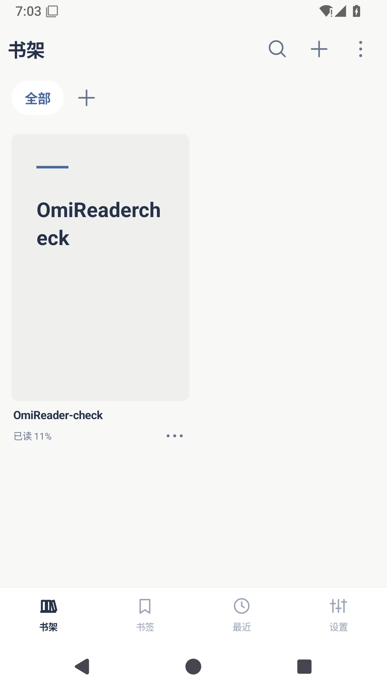
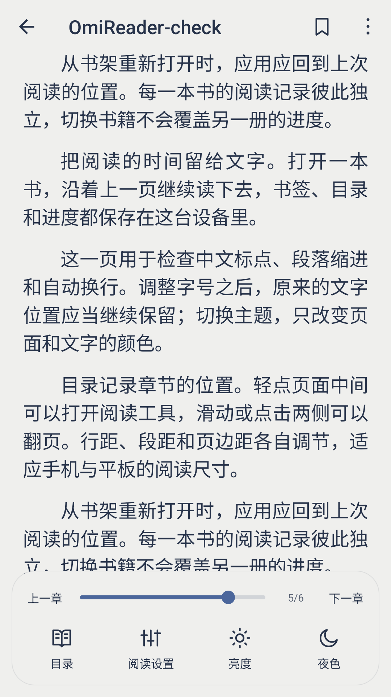
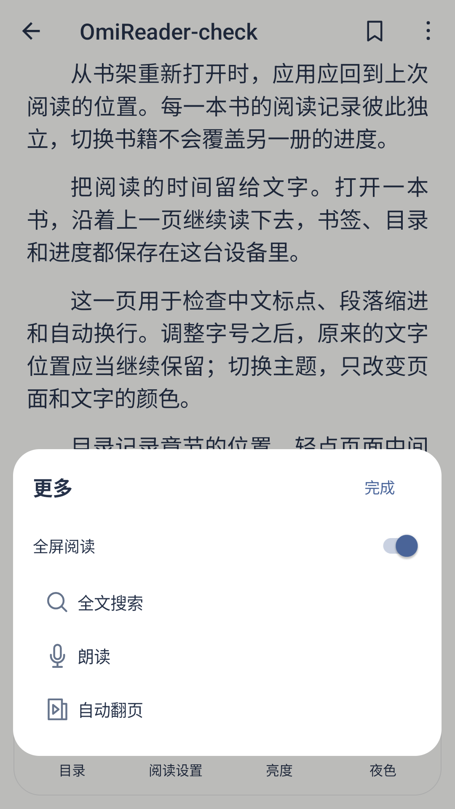
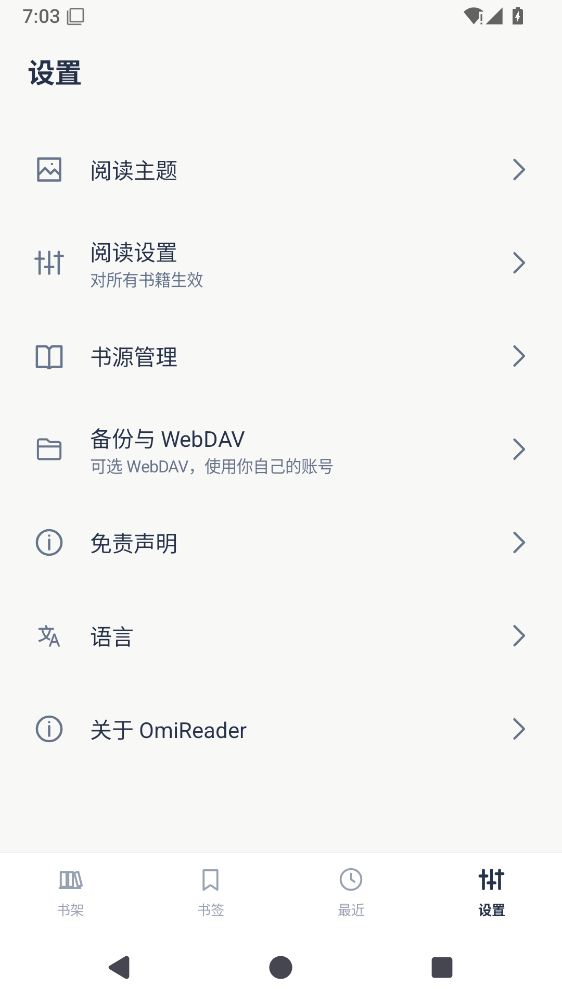
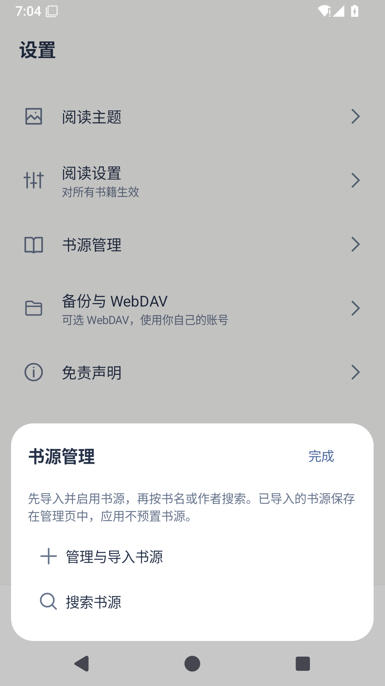
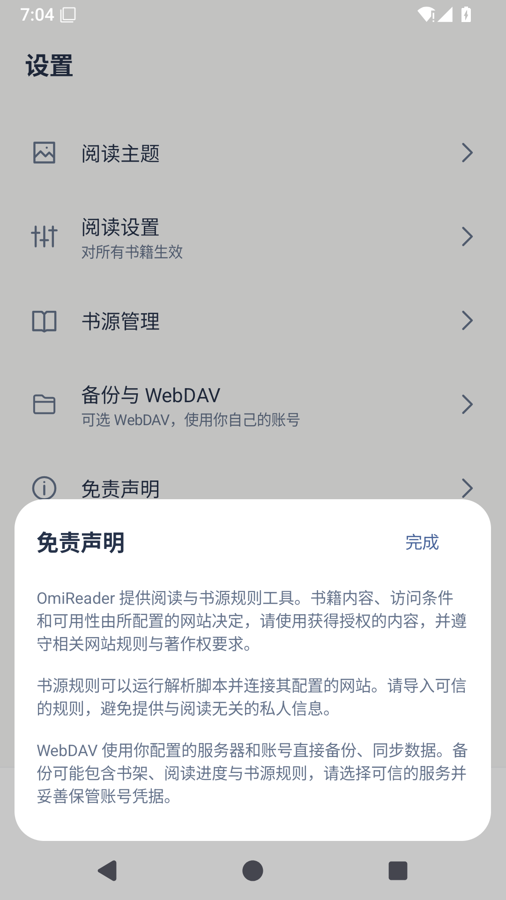

# OmiReader

[简体中文](README.md) · [繁體中文](README.zh-TW.md) · [English](README.en.md) · [日本語](README.ja.md)

[下载安装包](https://github.com/lorcinv/OmiReader/releases/latest) · [v1.1.3](https://github.com/lorcinv/OmiReader/releases/tag/v1.1.3)

Android 5.0+ · TXT / EPUB / MOBI / AZW3 / DOCX / Markdown · GPL-3.0

**把阅读的时间留给文字。**

OmiReader 是一款简洁的 Android 电子书阅读器，以本地书籍为主，提供完整的阅读调整、书架整理，以及可选的书源和 WebDAV。阅读核心基于 Legado，界面沿用 Omi 的配色与交互。

## 实际界面

<table>
<tr><td align="center"> 书架与阅读进度</td><td align="center"> 阅读设置与翻页进度</td><td align="center"> 精简的阅读菜单</td></tr>
<tr><td align="center"> 全局设置</td><td align="center"> 可选书源</td><td align="center"> 免责声明</td></tr>
</table>

## 功能

- **整理书架**：顶部书架分类、虚拟文件夹和封面叠放；支持 2–6 列与列表布局、长按整理和拖动排序。书籍超过一页时显示翻页胶囊。
- **调整阅读**：字体、字号、粗细、行距、字距、段距、缩进、页边距、书页颜色和背景均可设置。提供雾蓝、北境、暖沙、夜色四套 Omi 主题。
- **快速定位**：底部目录面板可以切换章节和书签；正文中的 EPUB、MOBI / AZW3 目录链接可跳转到章节或指定段落。顶部固定书签按钮，进度条显示实时页码，每本书独立保存续读位置。
- **简洁界面**：单排阅读工具、沉浸式全屏、灰色未选中底栏与清晰的当前状态。无广告 SDK，不要求注册账号。
- **可选联网**：导入兼容阅读 3.0 的 JSON 书源并搜索书籍；使用自己配置的 WebDAV 服务备份、恢复和同步。应用不预置第三方书源或书籍内容。

## 支持格式

| 格式 | 内容 |
| --- | --- |
| TXT | 文字重排、编码识别和章节目录 |
| EPUB | 文字、插图、目录与阅读进度 |
| MOBI / AZW3 | KF6 / KF8 文字与插图；纯图片页适配阅读区域 |
| DOCX | 段落、标题、列表、表格、链接和内嵌图片 |
| Markdown | `.md` / `.markdown`，支持标题、列表、引用、代码块和表格 |

支持未加密的文件。PDF 请使用 [OmiComic](https://github.com/lorcinv/OmiComic)；不提供独立 HTML 文件导入。Markdown 外部图片不会主动加载，DOCX 内嵌图片随文档保留。

## 开始使用

1. 从 [Releases](https://github.com/lorcinv/OmiReader/releases/latest) 下载 APK 并安装。1.1.3 沿用先前版本签名，可覆盖升级。
2. 点击书架顶部加号选择本地书籍；更多菜单提供批量导入和书架显示选项。
3. 轻点阅读页面中间显示工具栏；“阅读设置”保留完整排版与书页颜色选项。
4. 新建书架或文件夹时，输入名称后点右上角“完成”保存。
5. 如需书源：**设置 → 书源管理 → 管理与导入书源**。支持本地 JSON 文件和网址导入；导入并启用后，从“搜索书源”查找书籍。WebDAV 位于“备份与 WebDAV”。

## 数据与隐私

书架、书签和阅读位置保存在设备上。常规书籍优先保留系统授权的本地引用；DOCX、Markdown 使用内部阅读副本。书架分类不会移动原文件。书源和 WebDAV 会连接用户配置的对应服务，没有 OmiReader 中转服务器。联网功能的说明位于设置中的免责声明。

## 语言与开发

应用与项目说明支持简体中文、繁体中文、英文和日文。构建、签名及图标生成见 [BUILDING.md](docs/BUILDING.md)，版本记录见 [CHANGELOG.md](CHANGELOG.md)。

1.1.3 已通过 36 项 Android 模拟器检查，包含书内链接、锚点定位和原有阅读功能，并验证覆盖升级保留书籍和进度；尚无真机验证。遇到问题请提交 [Issue](https://github.com/lorcinv/OmiReader/issues)。

## 来源与许可

阅读与书源核心源自 [Legado · gedoor 及贡献者](https://github.com/gedoor/legado/tree/da17bb2bed44f30b12a524c2457e32a20b16fa41)。Omi 图标与交互参考同作者项目 [OmiComic](https://github.com/lorcinv/OmiComic)。保留上游署名、第三方许可和 [GPL-3.0](LICENSE)；上游介绍见 [UPSTREAM_README.md](docs/UPSTREAM_README.md)。
