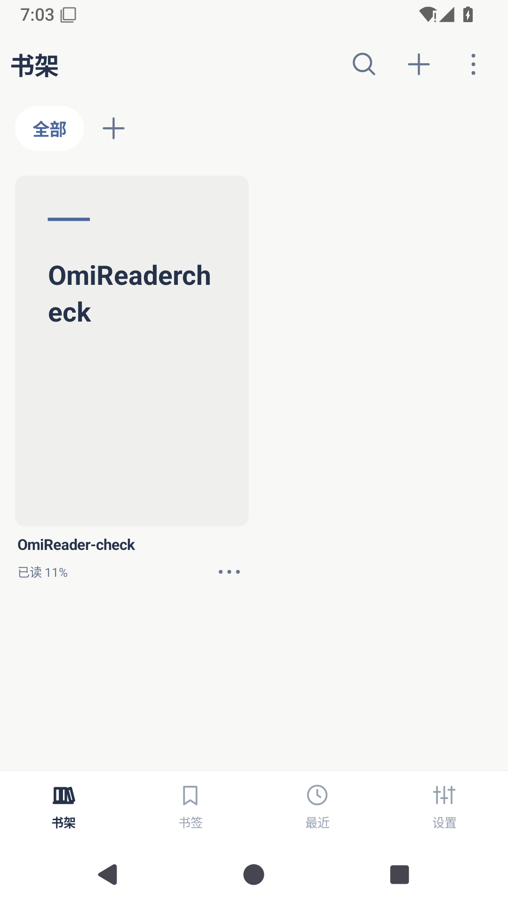
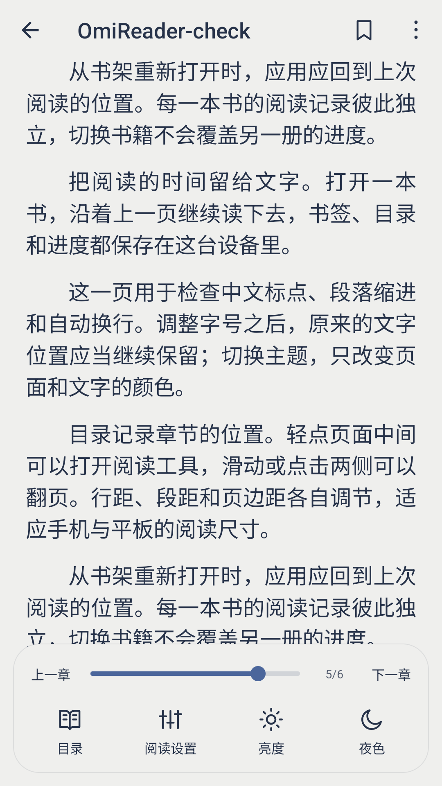
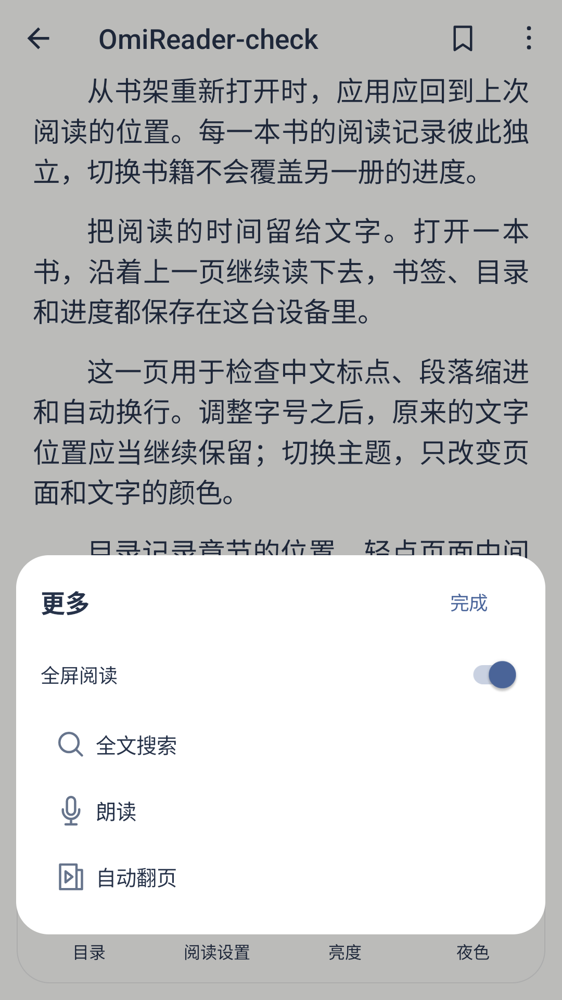
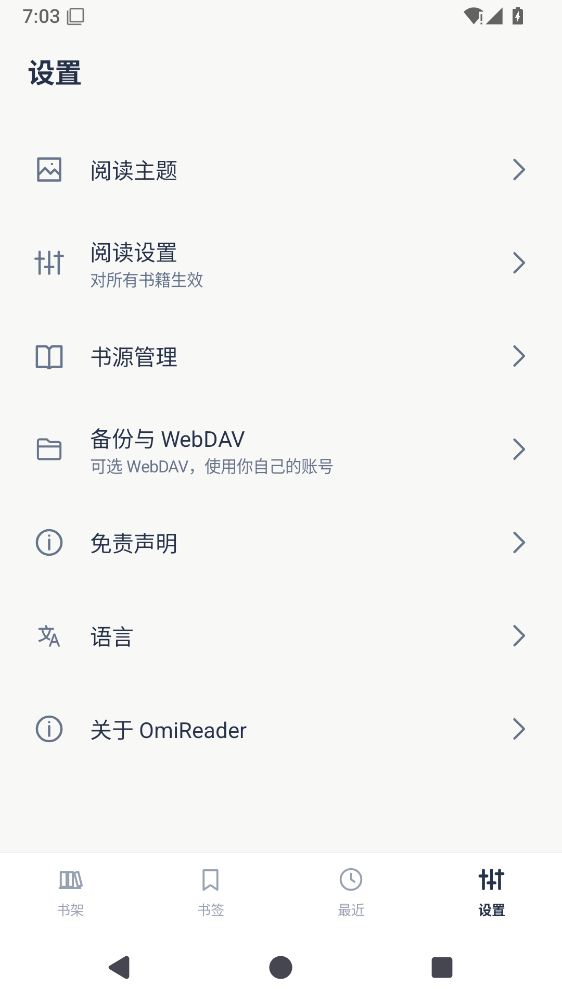
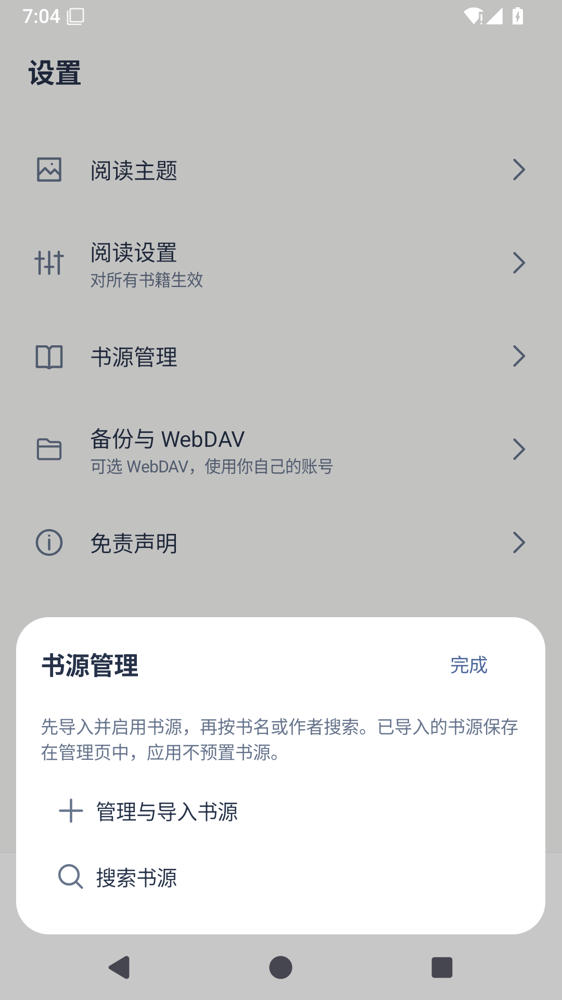
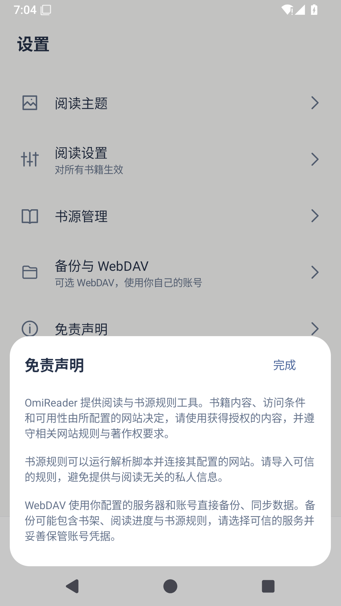

# OmiReader

[简体中文](README.md) · [繁體中文](README.zh-TW.md) · [English](README.en.md) · [日本語](README.ja.md)

[下載安裝包](https://github.com/lorcinv/OmiReader/releases/latest) · [v1.1.3](https://github.com/lorcinv/OmiReader/releases/tag/v1.1.3)

Android 5.0+ · TXT / EPUB / MOBI / AZW3 / DOCX / Markdown · GPL-3.0

**把閱讀的時間留給文字。**

OmiReader 是一款簡潔的 Android 電子書閱讀器，以本機書籍為主，提供完整的閱讀調整、書架整理，以及可選的書源與 WebDAV。閱讀核心基於 Legado，介面沿用 Omi 的配色與互動。

## 實際介面

<table>
<tr><td align="center"> 書架與閱讀進度</td><td align="center"> 閱讀設定與翻頁進度</td><td align="center"> 精簡的閱讀選單</td></tr>
<tr><td align="center"> 全域設定</td><td align="center"> 可選書源</td><td align="center"> 免責聲明</td></tr>
</table>

## 功能

- **整理書架**：頂部分類、虛擬資料夾與封面疊放；支援 2–6 欄與清單版面、長按整理及拖曳排序。書籍超過一頁時顯示翻頁膠囊。
- **調整閱讀**：字型、字級、粗細、行距、字距、段距、縮排、頁邊距、書頁顏色與背景皆可設定。提供霧藍、北境、暖沙、夜色四套 Omi 主題。
- **快速定位**：底部目錄面板可切換章節與書籤；EPUB、MOBI / AZW3 正文中的目錄連結可跳至章節或指定段落。頂部固定書籤按鈕，進度條顯示即時頁碼，每本書獨立保存續讀位置。
- **簡潔介面**：單排閱讀工具、沉浸式全螢幕、灰色未選中底部導覽與清楚的目前狀態。沒有廣告 SDK，不要求註冊帳號。
- **可選連線**：匯入相容閱讀 3.0 的 JSON 書源並搜尋書籍；使用自行設定的 WebDAV 服務備份、還原及同步。應用程式不預設第三方書源或書籍內容。

## 支援格式

| 格式 | 內容 |
| --- | --- |
| TXT | 文字重排、編碼辨識與章節目錄 |
| EPUB | 文字、插圖、目錄與閱讀進度 |
| MOBI / AZW3 | KF6 / KF8 文字與插圖；純圖片頁適配閱讀區域 |
| DOCX | 段落、標題、清單、表格、連結與內嵌圖片 |
| Markdown | `.md` / `.markdown`，支援標題、清單、引用、程式碼區塊與表格 |

支援未加密檔案。PDF 請使用 [OmiComic](https://github.com/lorcinv/OmiComic)；不提供獨立 HTML 檔案匯入。Markdown 外部圖片不會主動載入，DOCX 內嵌圖片隨文件保留。

## 開始使用

1. 從 [Releases](https://github.com/lorcinv/OmiReader/releases/latest) 下載 APK 並安裝。1.1.3 沿用先前版本簽章，可覆蓋升級。
2. 點選書架頂部加號以選擇本機書籍；更多選單提供批次匯入與書架顯示選項。
3. 輕點閱讀頁面中央顯示工具列；「閱讀設定」保留完整排版與書頁顏色選項。
4. 建立書架或資料夾時，輸入名稱後點選右上角「完成」儲存。
5. 需要書源時，開啟 **設定 → 書源管理 → 管理與匯入書源**。支援本機 JSON 檔案與網址匯入；匯入並啟用後，由「搜尋書源」尋找書籍。WebDAV 位於「備份與 WebDAV」。

## 資料與隱私

書架、書籤與閱讀位置保存在裝置上。一般書籍優先保留系統授權的本機參照；DOCX、Markdown 使用內部閱讀副本。書架分類不會移動原始檔案。書源與 WebDAV 會連線至使用者設定的服務，沒有 OmiReader 中轉伺服器。連線功能說明位於設定中的免責聲明。

## 語言與開發

應用程式與專案說明支援簡體中文、繁體中文、英文與日文。建置、簽章與圖示產生方式見 [BUILDING.md](docs/BUILDING.md)，版本紀錄見 [CHANGELOG.md](CHANGELOG.md)。

1.1.3 已通過 36 項 Android 模擬器檢查，包含書內連結、錨點定位與原有閱讀功能，並驗證覆蓋升級保留書籍與進度；尚未經實機驗證。遇到問題請提交 [Issue](https://github.com/lorcinv/OmiReader/issues)。

## 來源與授權

閱讀與書源核心源自 [Legado · gedoor 及貢獻者](https://github.com/gedoor/legado/tree/da17bb2bed44f30b12a524c2457e32a20b16fa41)。Omi 圖示與互動參考同作者專案 [OmiComic](https://github.com/lorcinv/OmiComic)。保留上游署名、第三方授權與 [GPL-3.0](LICENSE)；上游介紹見 [UPSTREAM_README.md](docs/UPSTREAM_README.md)。
